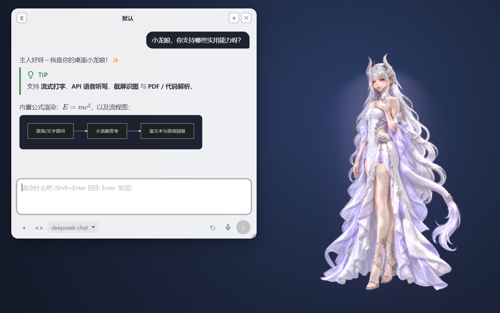
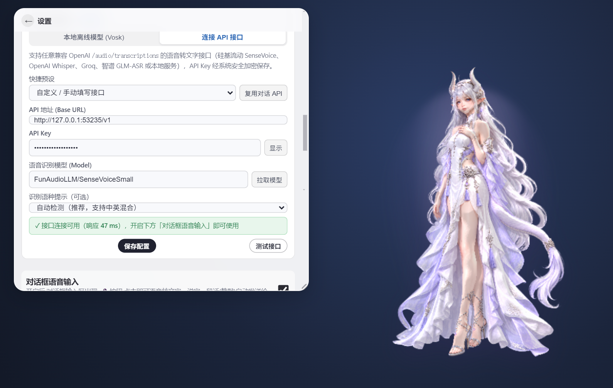

# 🐉 小龙娘桌宠 (Xiaolongniang Desktop Pet)

<p align="center">
  <a href="https://github.com/yiziyang-bit/xiaolongniang-desktop-pet/releases/latest">
    
  </a>
  <a href="./LICENSE">
    
  </a>
  
</p>

小龙娘是一个开箱即用的 **Windows 64 位高清 3D 视差桌面宠物**。无需配置任何编程运行环境，安装后即可在桌面上拖动她、摸摸头互动；首次启动会自动弹出 5 秒轻引导气泡，右键点她即可随时打开 AI 对话与丰富设置。

<p align="center">
  
</p>

| 💬 AI 富文本流式对话与文档识图 | 🎙️ 设置面板与双模语音识别（本地 Vosk / API 接口） |
| :---: | :---: |
|  |  |

---

## ⚡ 安装与快速上手

1. Windows 10 / 11（x64）用户在 Releases 下载 `XiaolongniangDesktopPet-*-Windows-x64-Setup.exe` 双击安装即可（**零额外环境依赖**，无需安装 Node.js / Python / .NET）。
2. 首次启动时，小龙娘头顶会弹出 5 秒引导提示（*“嗨～右键点我可以打开对话和设置哦！”*）；左键点头顶可摸头眨眼，按住身体可自由拖动，周围透明区域自动鼠标穿透，全屏看剧/游戏时自动隐身避让。
3. 安装目录与开始菜单会同步附带离线《[使用说明与功能介绍](./使用说明与功能介绍.md)》（`使用说明与功能介绍.html`），也可在**系统托盘右键菜单**或**设置面板**中一键打开。版本更新记录见 [CHANGELOG.md](./CHANGELOG.md)。

> **提示**：由于个人开源软件未附带商业代码签名证书，新电脑首次运行安装包若出现 Windows SmartScreen 蓝色提示框，点击 **「更多信息」→「仍要运行」** 即可正常安装。

---

## ✨ 可选扩展功能

- **AI 对话与读文档**：在「右键 → AI 设置」填入你自己的 OpenAI 兼容服务地址、模型和 API Key（支持 DeepSeek、硅基流动、智谱 GLM、通义千问、Kimi、OpenAI、OpenRouter、本地 Ollama 等），支持流式打字、随时中断、LaTeX 公式、Mermaid 流程图、全屏截屏识图以及 PDF / Word / Excel / 代码文件上传解读。桌宠通过 Windows 系统凭据加密机制（`safeStorage`）安全保存 API Key。
- **双模语音输入（语音转文字）**：在「设置 → 语音输入 → 语音识别模型」中支持两种方式自由选择：
  - **连接 API 接口（推荐）**：直接填入兼容 OpenAI `/audio/transcriptions` 的服务地址、API Key 与模型（如 `FunAudioLLM/SenseVoiceSmall`、`whisper-1`、`gpt-4o-mini-transcribe` 等），支持一键复用对话接口与连通性测试；
  - **本地离线模型**：导入 Vosk 小模型 ZIP（如 `vosk-model-small-cn-0.22.zip`）实现断网离线听写。
- **本地语音朗读（TTS）**：默认调用 Windows 系统自带语音朗读回复；进阶用户可在语音设置中指定本机 Python + `f5_tts` 资源目录启用克隆声（缺失或未配置时自动无缝回退系统语音）。
- **换角色（Hatch-Pet & Live2D）**：可在角色设置中导入 `pet.json` 与 `spritesheet.webp` 组成的 Hatch-Pet 目录；导入 Live2D 模型（`.model3.json`）需先从官方 SDK 免费获取 `live2dcubismcore.min.js` 放入「打开 Live2D 资源目录」。请使用自己信任且有权使用的模型和运行时。
- **MCP 工具、长期记忆与编程陪伴**：内置免装 Node.js 的本地文件系统工具（写操作默认二次确认），支持可视化长期记忆管理、主动时段/切窗问候，以及可选的本机 Codex 编程陪伴。

设置、导入素材和本地记忆保存在当前 Windows 用户的 `%APPDATA%\XiaolongniangDesktopPet`。

---

## 🛠️ 从源码构建

在 Windows x64 上安装 Node.js 22 或 24，然后在 `app` 目录执行以下命令：

```powershell
npm ci --registry https://registry.npmjs.org
npm run typecheck
npm test
npm run build:public
```

安装程序输出到 `app/dist-app/`。开发模式可运行 `npm run dev`。发布之前可从干净的源码检出重新构建，并用空白用户设置验证首次启动。

---

## 📜 许可与致谢

小龙娘原立绘由抖音作者 **很细嘟嘟** 创作，已获原作者授权用于本桌宠项目。立绘与配套素材见[素材说明](./ASSETS.md)。

项目基于 [Desktop-pet](https://github.com/git2968/Desktop-pet)，代码保留上游 MIT 许可和版权声明，见 [LICENSE](./LICENSE)。用户自行获取的第三方模型、音频和 SDK 遵循各自的许可证。
